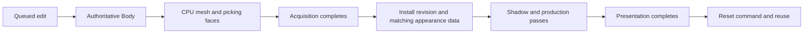

# Baseline milestone 7 constraints

This note records inspection of baseline `928bee9e677983c063811e0540f8783d86467a83` before milestone 7. Source citations are pinned to that revision and its dependencies. Current contracts are in the [API reference](../docs/api.md) and [voxel reference](../docs/voxel.md). Completion terminology is qualified in the [measurement review](m7-measurement-review.md).

Milestone 7 crosses two boundaries: derived geometry must become incremental, and native ownership must support overlapping submissions. The explorer reports agree; source checks confirm that adding frame slots alone cannot enable overlap.

Today, each cut rebuilds the entire CPU mesh. A changed revision replaces both GPU buffers with directly written host-visible buffers. The application then serializes acquisition, rendering, presentation completion, and command reset.

`Body` remains authoritative; `Mesh` contains derived picking faces and packed arrays; `Scene.Group` holds installed geometry and production assets. Native `BvRow` records own Vulkan objects and track references between them.

The architecture must honor these constraints:

- **Preserve edit ordering and coherent frame snapshots.** `interactive.events` processes each event against the preceding event's updated world. Picking therefore sees freshly rebuilt CPU faces even while an earlier GPU frame remains active. Dirty chunks must preserve that behavior, including cut/cut/reset/cut sequences. Each submitted frame needs a coherent geometry revision, camera, hover selection, and appearance payload. The current installation boundary is acquisition-fence success. See [interactive.bend](https://github.com/aivv73/bend-vulkan/blob/928bee9e677983c063811e0540f8783d86467a83/examples/voxel/interactive.bend#L275).

- **Treat chunks as derived ownership, with cross-boundary occupancy.** Dense bodies and cuboid bodies currently use different extraction paths before packing. Chunking must respect both representations, invalidate neighboring surface owners, and emit every exposed cell side exactly once. Greedy merging must preserve material, direction, plane, winding, coverage, and owning-cell identity. Existing rectangles already carry anchor and extent metadata. However, changing rectangle boundaries changes floating-point intersection arithmetic: the production shader divides by extent, multiplies back, floors, and clamps to recover a cell. Geometric equivalence alone cannot establish appearance equivalence. See [mesh.bend](https://github.com/aivv73/bend-vulkan/blob/928bee9e677983c063811e0540f8783d86467a83/examples/voxel/mesh.bend#L188) and [appearance_common.glsl](https://github.com/aivv73/bend-vulkan/blob/928bee9e677983c063811e0540f8783d86467a83/shaders/appearance_common.glsl#L37).

- **Build upload reuse on the existing primitives.** Destination-offset packed writes and offset-based GPU buffer copies already exist. Packed writes lack a source-array offset, return the array on every outcome, and enforce a 16 MiB limit. Host access exclusion covers the entire memory allocation, so separate frame allocations are compatible with current checks; disjoint regions of one busy staging allocation are not. Transfer visibility barriers remain explicit. See [native.c](https://github.com/aivv73/bend-vulkan/blob/928bee9e677983c063811e0540f8783d86467a83/src/native.c#L2049).

- **Separate GPU completion from reference retirement.** Completion removes submission associations but retains recorded resource references. Successful command reset or pool destruction releases those references; failed reset retains them. Descriptor updates also reject sets referenced by completed recordings. Deferred reclamation therefore needs completion evidence **and** removal of every recorded reference. Submission generations must distinguish successive uses of a reusable fence. See [completion](https://github.com/aivv73/bend-vulkan/blob/928bee9e677983c063811e0540f8783d86467a83/src/native.c#L249) and [command reset](https://github.com/aivv73/bend-vulkan/blob/928bee9e677983c063811e0540f8783d86467a83/src/native.c#L2588).

- **Change the native concurrency model as one unit.** Submission rejects any existing active command. Acquisition permits one device-wide lease and rejects previous swapchain recordings. `bv_memory_busy` examines only the first active command; `bv_idle` completes only one; `bv_complete` updates the global lease without identifying its acquisition. These assumptions must change together. Preserve timeout retention, uncertain-submission recovery, device-loss cleanup, semaphore provenance, and presentation's separate completion fence. See [submission](https://github.com/aivv73/bend-vulkan/blob/928bee9e677983c063811e0540f8783d86467a83/src/native.c#L2447) and [acquisition](https://github.com/aivv73/bend-vulkan/blob/928bee9e677983c063811e0540f8783d86467a83/src/native.c#L2745).

- **Protect every mutable frame resource.** Independent commands and fences do not protect the shared camera uniform, descriptors, shadow attachment, or presentation depth attachment. Give these resources safe per-frame ownership or explicit ordering. Geometry generations must remain valid for every referencing frame. Keep `Scene.record` shared between offscreen evidence and interactive production rendering so both exercise the same shadow/backdrop/world/rings behavior. See [scene.bend](https://github.com/aivv73/bend-vulkan/blob/928bee9e677983c063811e0540f8783d86467a83/examples/voxel/scene.bend#L185).

One qualification matters: current oversized-upload rejection occurs before releasing installed geometry, but ordinary replacement releases old buffers before allocating replacements. That test does **not** establish transactional replacement under allocation or upload failure. See [renderer.bend](https://github.com/aivv73/bend-vulkan/blob/928bee9e677983c063811e0540f8783d86467a83/examples/voxel/renderer.bend#L121).

Acceptance must evolve deliberately. The geometry oracle pins ordering, cuboid source boundaries, and quad counts alongside independent coverage; optimized paths need suitable semantic checks while retaining baseline evidence. The repeated-submission test explicitly expects second-submit rejection and must change with concurrency support. Preserve exact identity/coverage checks, production appearance and shadow causality, repeat/reset behavior, synchronization validation, sanitizers, and bounded resources. New overlap evidence should demonstrate two pending frames, distinct frame data, safe retirement, and recovery.

Measure completed displayed frames, separating meshing, upload, GPU rendering, and presentation costs. Current counters provide no timing attribution, and timestamp-query bindings are absent. Tune Bend parallel meshing and GPU overlap separately; defer optional suballocation and workload-dependent culling/batching as [milestone 7 specifies](https://github.com/aivv73/bend-vulkan/blob/928bee9e677983c063811e0540f8783d86467a83/docs/roadmap.md#L223).

Keep voxel ownership above the generic wrapper; extend the manifest and handwritten native implementation, then regenerate. Add pure invariants to `LAWS.bend`, prove them through `PROOF.bend`, and retain runtime gates for native behavior. No benchmarks or verification suites were executed during this read-only synthesis.
