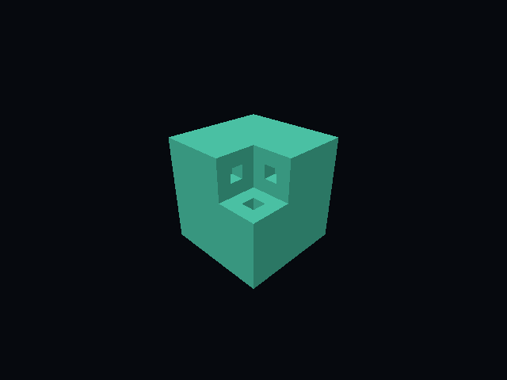

# bend-vulkan

A native Vulkan wrapper for Bend, inspired by [ash](https://github.com/ash-rs/ash).
The implementation provides explicit instance, device, buffer, image, memory, command-buffer, fence, render-pass, framebuffer, shader, and indexed graphics operations.
Vulkan 64-bit sizes, offsets, and alignments use the actual two-limb `U64` from [bend-collections](https://github.com/Giulio2002/bend-collections).

This is a 64-bit Linux Vulkan 1.0 subset with optional X11 presentation. It supports capability discovery, explicit barriers, packed array uploads, GPU transfers, fence-backed command reuse, color/depth attachment clears, and indexed depth-tested draws.
Images use a six-format, optimal-tiled 2D profile with explicit mips, layers, binding, views, and staging readback.
X11 presentation requires `VK_EXT_swapchain_maintenance1`. Headless binaries keep the Vulkan 1.0 path and load no X11 library.
Descriptors, callbacks, and general `pNext` chains are not implemented.

## Run the buffer example

Use Linux with glibc 2.34 or newer. Install Bend **2.0.37**, Clang, Python 3, Vulkan development headers, `libvulkan.so.1`, and a Vulkan driver.
A hardware driver or a software ICD such as Lavapipe can provide the device.
The examples select a graphics queue for transfer commands.

Initialize the pinned dependencies:

```sh
git submodule update --init --recursive
```

Build and run the native example:

```sh
mkdir -p build
bend examples/buffer_roundtrip.bend -o build/buffer-roundtrip
./build/buffer-roundtrip
```

Expected output:

```text
Host roundtrip and GPU buffer fill verified
```

The example writes four bytes to Vulkan memory and checks their readback.
It then records `vkCmdFillBuffer`, submits the command buffer, waits for completion, and checks sixteen bytes against the value `42`.
Build and run `examples/discover.bend` the same way to list layers, extensions, devices, heaps, format masks, and selected limits.
It prints U64 values as low/high limbs.

## Run the image example

Build and run the offscreen example after initializing the dependency:

```sh
bend examples/offscreen_roundtrip.bend -o build/offscreen-roundtrip
./build/offscreen-roundtrip
```

Expected output:

```text
Optimal RGBA8 image clear and every-pixel readback verified
```

The example queries the exact image configuration and clears a 4 by 4 RGBA8 image to magenta.
It transitions the image, copies all 64 bytes to a host-readable buffer, waits for fence completion, and compares every pixel.
The bytes are row-major `R,G,B,A`, with `y=0` as the first row. The example defines that row as the top.
Optimal image memory has no public linear pixel stride. Readback uses a buffer with explicit copy strides.

`bend example.bend` uses Bend's JavaScript backend. Vulkan effects report a native-build-required error in that backend.

## Run indexed graphics

Build and run the indexed example:

```sh
bend examples/indexed_offscreen.bend -o build/indexed-offscreen
./build/indexed-offscreen
```

It compares every RGBA8 and D32 pixel for overlapping red and green surfaces in both draw orders.
Both UINT16 and UINT32 indices use nonzero offsets and base vertex -3. A nonsymmetric column-major camera matrix transforms the mesh.
The [graphics contract](docs/api.md#example-mesh-and-camera-contract) defines byte strides, matrix order, depth, winding, and image orientation.
GLSL and mesh packing belong to the example. The wrapper accepts configurable vertex input, rasterization, depth comparison, color masks, and generic push words.

The shader words are checked in. The complete verifier also requires `glslc` and `spirv-val`.
To rebuild the words after editing GLSL, run:

```sh
python3 tools/build_shaders.py
```

## Run the voxel consumer

Build the pinned dense-body consumer and export the intact and carved cube:

```sh
bend examples/voxel_offscreen.bend -o build/voxel-offscreen
./build/voxel-offscreen
```

It writes 512 by 512 frames to `build/voxel-intact.ppm` and `build/voxel-carved.ppm`.
It also exports the reset/empty frames and the pinned upstream renderer's visual references.
The [voxel contract](docs/voxel.md) defines packing, projection, edge comparison, ownership, and verification limits.
Actual GPU checks cover full U32 material bytes, all six directions, edits, empty meshes, and camera frames without mesh uploads.
The reference renderer runs on the CPU. CUDA is not a prerequisite.

## Run the interactive cube

Build and run the native X11 consumer:

```sh
bend examples/voxel_interactive.bend -o build/voxel-interactive
./build/voxel-interactive
```

Use WASD and Q/E to fly, hold RMB to look, click to carve, press Space for the demo cut, and press R to reset the cube.
Escape and the native window close button exit. Resize and minimize preserve input and world state.
Brush preview remains deferred to milestone 6. The [presentation contract](docs/presentation.md) describes requirements, ownership, and completion.



## Use the API

Import `Vulkan.bend`, `src/core.bend`, `src/constants.bend`, and the dependency's `src/math/u64.bend` with paths relative to your program.
The executable [buffer example](examples/buffer_roundtrip.bend) shows allocation and fill submission.
The [repeated transfer check](tests/repeated.bend) shows packed upload, explicit barriers, general submission, finite completion, and reset/re-recording.
The [rendering check](tests/rendering.bend) shows Vulkan 1.0 color/depth passes, partial-area clears, and framebuffer-only lifetime protection.
The [indexed graphics acceptance](tests/indexed_graphics.bend) checks clipping, winding, viewport/scissor, changing pushes, lifetime, and 32 stable reuses.
The [image reuse check](tests/image_repeated.bend) runs 32 changing color/depth passes and 32 resource churn cycles.

`V.Action(A)` is `IO(V.VkResult(A))`. A `do V.Action<Unit>:` block propagates returned failures.
`V.Entry.with(Unit, entry => run(entry))` loads the Vulkan library, runs your callback, and closes its resource tree after either `Done` or `Fail`.
Use `V.or_exit(Unit, result)` at the application boundary to report the final result.
Calling `IO.die`, `IO.exit`, or `IO.try` inside a resource scope bypasses that cleanup callback.

Handle values are copyable with Bend's `+` annotations. Each handle kind has a distinct type.
Native code validates registry keys, object kinds, ownership, and liveness before it calls Vulkan.
Explicit destroy operations reject live dependents. `Entry.close` releases descendants in dependency order.
Dropping a Bend handle value does not destroy its Vulkan object.

See [the API reference](docs/api.md) for supported operations and [the design](docs/design.md) for the FFI and ownership decisions.
See the [roadmap](docs/roadmap.md) for milestone status and remaining renderer work.

## Verify changes

Run the generator check, proof gate, native examples, and negative integration checks:

```sh
python3 tools/verify.py
```

To include address and undefined-behavior sanitizers:

```sh
python3 tools/verify.py --sanitize
```

Require native-window acceptance as well as the complete headless suite:

```sh
python3 tools/verify.py --sanitize --presentation
```

On a Wayland desktop, an isolated X11 display avoids other applications' pointer grabs:

```sh
python3 tools/verify.py --sanitize --presentation --isolated-display
```

This option requires rootful Xwayland. Window verification also requires Python Pillow and ImageMagick `import`.
Presentation checks run only with `--presentation`. The default suite remains usable without `DISPLAY`.

The native checks include 32 alternating packed uploads copied through a device-local intermediate GPU buffer to literal readback bytes.
They reuse command/pool/fence objects, check stable row counts, and reject pending reset, destruction, mapping, and further submission before observing completion.
Separate checks cover fence status/wait/idle completion, retained references, stale/wrong-owner keys, and zero remaining objects after successful and accepted-pending failure scopes.
Native and interpreted probes read the returned upload array after success and rejection.
Image checks compare every color/depth pixel, nonuniform padded two-layer copies at a nonzero mip, and untouched pixels and buffer sentinels.
They cover RGBA/BGRA UNORM/SRGB channel order, D32 depth `0.5`, and D16 depth `1.0` readback.
Pass tests establish layouts in a separate completed and reset recording before submitting only framebuffer begin/end.

`tools/check_native.py` adds controlled dispatch/allocation probes only to emitted test C.
These exercise submit OOM/uncertainty, wait/idle/reset errors, map/flush failure ownership, metadata allocation failures, enumeration retries, composite ABI, private-fence isolation, and sticky device loss.
Injected results are distinct from real GPU execution. The tests never provoke hardware loss.
The sanitizer run includes those probes, the real repeated transfer test, and indexed graphics acceptance.
The emitted-test allocator counts all wrapper metadata allocations, and teardown asserts both zero metadata allocations and zero registry rows.
Driver-global leak detection is disabled for ASan. These explicit counters cover wrapper cleanup.
The verifier records queried device/layer output in `build/discovery.txt` and validation availability in `build/validation.txt`.
When Khronos validation is installed, it also runs the real GPU checks with synchronization validation enabled.
A missing driver or device fails native verification. It is not a passing skip.
Bend's pure laws live in `LAWS.bend`; their proofs live in `PROOF.bend`.
Before committing, run `bend PROOF.bend`. For the additional proof-kernel check, run `bend PROOF.bend --verdict`.
The laws cover pure functions. They do not verify C code, Vulkan drivers, or GPU execution.

`tools/bindings.json` defines the supported effects. `tools/generate.py` generates their Bend declarations, native registrations, JavaScript errors, and selected core constants from the checked-in Khronos registry extract.
Run `python3 tools/generate.py` after changing the manifest. The generator does not implement new native commands or translate arbitrary Vulkan structs.

The milestone-3 run on NVIDIA GeForce GTX 1660 passed `python3 tools/verify.py --sanitize` with Khronos and synchronization validation available.
Optimal color image requirements exposed no compatible host-visible memory type on that device.
Real lifetime rejection and pixels use the driver and staging. Post-completion mapped access in the graph probe uses controlled dispatch and is labeled separately.
Noncoherent cache paths have controlled flush-failure coverage. Their driver coverage depends on the selected memory type.

The milestone-4 consumer also passes the complete sanitize suite on that device, including whole-frame reference checks, GPU metadata diagnostics, bounded edits, and zero-row cleanup.
Its native translation unit preprocesses and builds without CUDA support.
