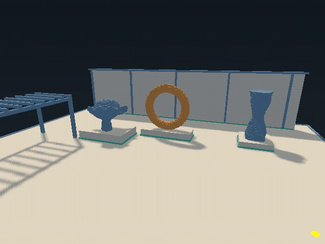

# bend-vulkan

A native Vulkan wrapper for Bend, inspired by [ash](https://github.com/ash-rs/ash).
It provides explicit GPU memory, command recording, synchronization, and indexed graphics on 64-bit Linux.

The included voxel renderer runs the editable Atelier scene from [bend-voxel](https://github.com/aivv73/bend-voxel), with material lighting, sun shadows, and a brush preview.



Camera flight and close-up brush cuts in the native application. Playback at 4× speed.

## What works

The wrapper implements a Vulkan 1.0 subset with optional X11 presentation:

- Device and capability discovery, buffers, memory allocation, packed uploads, and GPU transfers.
- Optimal-tiled 2D color and depth images, staging readback, render passes, and indexed depth-tested draws.
- Uniform-buffer and combined-image-sampler descriptors, push constants, and timestamp queries.
- Explicit barriers, fences, semaphores, command reuse, and independent submissions.
- Checked handles, scoped cleanup, and deferred retirement of buffers referenced by recorded commands.

The renderer uses sparse chunks, greedy shadow geometry, reusable staging, and two frame slots.
The [roadmap](docs/roadmap.md) tracks implemented work and planned API and platform expansion.

## Build your first example

Install these prerequisites:

- 64-bit Linux with glibc 2.34 or newer.
- **Bend 2.0.39**, the version required by the native effect ABI.
- Clang, Python 3, Vulkan development headers, and `libvulkan.so.1`.
- A Vulkan driver with a graphics queue. A software driver such as Lavapipe is sufficient for the buffer example.

Confirm that `bend version` prints `bend 2.0.39`. From the repository root, initialize the pinned dependencies and build:

```sh
git submodule update --init --recursive
mkdir -p build
bend examples/buffer_roundtrip.bend -o build/buffer-roundtrip
./build/buffer-roundtrip
```

Expected output:

```text
Host roundtrip and GPU buffer fill verified
```

The example checks a host-memory roundtrip, fills a buffer on the GPU, and compares the readback bytes.
Headless examples need no display or X11 library. CUDA is not required.

Use `-o` to build a native executable. Running `bend examples/buffer_roundtrip.bend` directly selects the JavaScript backend, where Vulkan effects return a native-build-required error.

## Run the Atelier demo

Complete the setup above, then install X11 development headers and `libX11.so.6`.
The demo requires an X11 display, sampled D32 depth images, and the [presentation extensions](docs/presentation.md#api-profile), including `VK_EXT_swapchain_maintenance1`.

```sh
bend examples/voxel_interactive.bend -o build/voxel-interactive
./build/voxel-interactive
```

| Input | Action |
| --- | --- |
| WASD, Q/E | Move the camera |
| Hold right mouse button | Look around |
| Left click or Space | Carve the hovered surface with a 20 cm brush |
| R | Restore the scene while keeping the camera |
| Escape or window close | Exit |

Resize and minimize preserve the world state. Normal runs are quiet; add `--trace` for diagnostics.
Use `--cube` for the basic cube demo, where Space applies the fixed demo cut.

The default is `--slots=2`; `--slots=1` uses one frame slot. Set Bend's CPU worker count separately with runtime options:

```sh
./build/voxel-interactive +RTS --threads 4 -RTS --slots=2
```

See the [presentation contract](docs/presentation.md) for input, frame ownership, and completion behavior.

## Explore the headless examples

Build any example with the same `bend <source> -o <binary>` command:

| Source | What it demonstrates |
| --- | --- |
| [discover.bend](examples/discover.bend) | Enumerate devices, layers, extensions, memory heaps, formats, and limits |
| [buffer_roundtrip.bend](examples/buffer_roundtrip.bend) | Host memory access and GPU buffer fill |
| [offscreen_roundtrip.bend](examples/offscreen_roundtrip.bend) | Clear an RGBA8 image and verify every pixel through staging readback |
| [indexed_offscreen.bend](examples/indexed_offscreen.bend) | Verify indexed draws and depth occlusion with UINT16 and UINT32 indices |
| [voxel_offscreen.bend](examples/voxel_offscreen.bend) | Export intact, carved, reset, and empty cube frames alongside CPU reference images |

For example, export the voxel frames:

```sh
bend examples/voxel_offscreen.bend -o build/voxel-offscreen
./build/voxel-offscreen
```

The intact and carved images are `build/voxel-intact.ppm` and `build/voxel-carved.ppm`, both 512 × 512 pixels.
The [voxel contract](docs/voxel.md) defines packing, projection, and reference comparisons.

## Use the library

Import [Vulkan.bend](Vulkan.bend) for the public API, [src/core.bend](src/core.bend) for selection helpers, and [src/constants.bend](src/constants.bend) for Vulkan constants.
Sizes, offsets, and alignments use the two-limb `U64` in [bend-collections](https://github.com/Giulio2002/bend-collections), at `deps/bend-collections/src/math/u64.bend`.
Import paths are relative to your Bend source file.

Start with the [buffer example](examples/buffer_roundtrip.bend). Its resource scope uses `V.Entry.with(Unit, entry => run(entry))` to load Vulkan and clean up after either success or a returned failure.
`V.Action(A)` is `IO(V.VkResult(A))`; `do V.Action<Unit>:` propagates returned failures.
Use `V.or_exit` at the application boundary. Calling `IO.die`, `IO.exit`, or `IO.try` inside the scope bypasses its cleanup callback.

Handles have distinct types and are copyable with Bend's `+` annotations. Dropping a handle does not destroy its Vulkan object.
The native registry checks ownership and liveness. Explicit destruction rejects live dependents; closing an entry releases its descendants in dependency order.
Callers remain responsible for Vulkan validity requirements for their flags, extensions, and resource use.

The [API reference](docs/api.md) documents supported operations and limits. The [design document](docs/design.md) explains native dispatch, the compiler ABI, and resource lifetimes.
General `pNext` chains, allocation callbacks, and platforms beyond Linux are outside the current scope.

## Verify changes

The complete headless suite also requires NumPy, Pillow, `glslc`, `spirv-val`, and `vulkaninfo` from vulkan-tools.
Its production renderer checks require sampled D32 support.

```sh
python3 tools/verify.py
```

The suite checks generated files and pure proofs, runs GPU readback and rendering comparisons, and exercises lifetime and failure handling.
It enables Khronos and synchronization validation when the validation layer is installed. A missing Vulkan device fails verification.
Reports and captures go under `build/`, including `discovery.txt` and `validation.txt`.

To include AddressSanitizer and UndefinedBehaviorSanitizer:

```sh
python3 tools/verify.py --sanitize
```

To include native-window checks, install the demo's X11 dependencies and ImageMagick's `import` command, then run:

```sh
python3 tools/verify.py --sanitize --presentation
```

On a Wayland desktop with rootful Xwayland, add `--isolated-display` to run the window checks on a private X11 display.
The default suite needs no `DISPLAY`.

Pure rules live in [LAWS.bend](LAWS.bend), with proofs in [PROOF.bend](PROOF.bend). Before committing, run:

```sh
bend PROOF.bend
```

These proofs cover pure functions, not native C code or GPU execution.
The optional `bend PROOF.bend --verdict` kernel check has a known mismatch on the unchanged 3,072-quad index-bound law.

Bindings come from [tools/bindings.json](tools/bindings.json) and the checked-in registry extract. After changing the manifest, regenerate them:

```sh
python3 tools/generate.py
```

Shader words are checked in, so examples do not need a shader compiler to build. After editing GLSL, regenerate them with:

```sh
python3 tools/build_shaders.py
```

For full Atelier offscreen captures and appearance checks, run the reference checker first:

```sh
python3 tools/check_reference_lighting.py
python3 tools/check_production.py --sanitize
```

Captures and reports go to `build/milestone-6-production/`.
The [voxel verification policy](docs/voxel.md#verification-policy) distinguishes exact state checks from bounded appearance comparisons.
[Milestone 7 evidence](.audit/m7-results.md) records acceptance on NVIDIA GeForce GTX 1660 and the limits of the performance measurements. No implementation speedup has been established.
